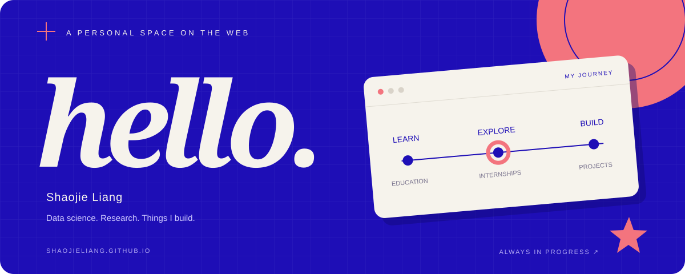

<p align="center">
  <a href="https://shaojieliang.github.io/">
    
  </a>
</p>

<h1 align="center">hello，欢迎来到我的个人空间。</h1>

<p align="center">从国际贸易到数据科学，把学习、研究和做过的项目串成一段故事。</p>

<p align="center">
  <a href="https://shaojieliang.github.io/"></a>
  <a href="https://shaojieliang.github.io/pl/historia/all/"></a>
  <a href="https://shaojieliang.github.io/pl/about/"></a>
</p>

<p align="center"><sub>个人网站 · 交互实验 · 持续完善中</sub></p>

---

## 先逛逛

这是我的个人网站，也是一个持续迭代的交互实验。用完整的开场动画打个招呼，再通过可以互动的舞台和横向时间线，记录我的教育、实习与项目经历。

| 入口 | 可以看到什么 |
| :--- | :--- |
| [↗ 首页](https://shaojieliang.github.io/) | hello 开场、落下的施工告示板，以及跟随鼠标变化的木偶舞台 |
| [↗ 经历时间线](https://shaojieliang.github.io/pl/historia/all/) | 9 段经历按时间展开，支持教育、实习、项目筛选与详情切换 |
| [↗ 关于我](https://shaojieliang.github.io/pl/about/) | 数据科学背景、常用工具、荣誉和课堂之外的生活 |

## 一点交互，一点个性

**01 / 从 hello 开始**  
完整播放开场转场，随后告示板落下并轻轻摇摆。网站还在建设，先来打个招呼。

**02 / 和舞台打个招呼**  
移动鼠标观察视差，点击小人触发动作。声音默认关闭，可以通过页面上的声音按钮开启。

**03 / 沿着时间走**  
2 段教育、3 段实习、4 个项目。点击年份或图片查看详情，用箭头切换，也可以按类别浏览。

## 关于这段旅程

目前在蒙纳士大学学习数据科学，本科就读于宁波大学国际贸易学专业。实践横跨金融研究、用户分析与数据工具开发。

项目里有连接训练与身体数据的 **FitTrack**，也有电商数据质量分析、智慧交通与停车预测，以及贸易和碳排放相关研究。

## 怎样搭起来的

<p>
  
  
  
  
  
  
</p>

页面使用 HTML、CSS 和 JavaScript；舞台由 Canvas 2D 绘制，动画沿用 GSAP、jQuery 等前端组件。网站通过 GitHub Pages 静态发布。

<details>
<summary><strong>开发与页面结构</strong></summary>

```text
.
├── index.html                 # 首页
├── personal.css               # 个人内容与中文排版适配
├── personal.js                # 施工告示板与默认静音
├── pl/
│   ├── about/                 # 关于我
│   └── historia/
│       ├── all/               # 全部经历
│       ├── 1945-49/           # 教育经历（沿用原内部路径）
│       ├── internships/       # 实习经历
│       └── 1950-59/           # 项目经历（沿用原内部路径）
├── public/                    # 脚本、样式、字体与视觉素材
└── docs/cover.svg              # 仓库介绍封面
```

在仓库根目录运行静态服务器即可本地查看：

```bash
python -m http.server 8000
```

打开 `http://localhost:8000/`。经历页面路径保留末尾的 `/`，以便原页面切换组件正确匹配。`/me/` 兼容旧主页链接，已有的 `/true-camera-mirror/` 摄像头工具独立保留。

</details>

## 还在继续

- [x] hello 开场与施工告示板
- [x] 鼠标互动舞台
- [x] 教育、实习与项目时间线
- [x] GitHub Pages 上线
- [ ] 用个人素材替换时间线占位配图
- [ ] 继续打磨移动端体验和页面细节

## 设计来源与素材

网站的视觉结构、动画代码、木偶、字体与历史占位配图来源于 [Teatr Lalka](https://teatrlalka.pl/)，相关素材权利归原作者所有。经历文字整理自个人简历，历史配图已在详情中标明为视觉占位，并非个人经历实拍。本仓库不为第三方代码和素材授予额外许可。

---

<p align="center"><strong>保持好奇，慢慢向前。</strong><br /><sub>Built with curiosity · Always in progress</sub></p>
